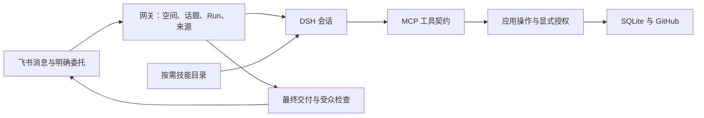

# 工作流与工程边界

本片延续单进程 SQLite 与 DSH ACP。正式研发状态仍在 GitHub，Friday 只保存会话、来源、反馈案件与执行回执，不新增一套项目状态平台。

## 各层只负责什么

- **常驻指令**只定义角色、证据标准、行动边界和沟通方式。用户、仓库、时间、来源与偏好从本轮可信上下文传入；不内嵌成员名单、仓库名称、工具预算或开发机联网假设。
- **技能**定义场景方法。DSH 从目录的 name/description 发现技能，需要时加载正文；发布恢复、案件续接、事项维护等分支使用 references。不引入关键词路由器，也不按技能名授予权限。
- **MCP**描述实际参数与回执；动态技能名称规则复用同一校验。工具说明不得与技能冲突，例如只问已知信息不自动创建 Wiki、普通报障不自动登记。
- **API**检查实际动作。`need` 校验 capability 和当前运行身份；`needDerivedWrite`、`needConfigure`、`needMemoryWrite`、`needRepositoryWrite` 各处理对应来源与资源边界。无 `scope.endsWith(':write')` 猜测，没有新通用事件框架。跨 await 后再次检查是撤权窗口保护，不是吞掉错误的兜底。
- **业务存储**保存可恢复事实。GitHub 是 issue/PR 状态源；反馈案件保存待补信息和证据引用；PMO 只投影已授权快照，显示覆盖与历时口径。
- **投递**由网关负责。普通执行不创建过程卡，不发送后撤回；长结果与审批卡是独立交互。当前仅普通最终回答已接投递账本，其他出站仍须继续迁移。

## 本片场景改进

新增 `friday-workspace-guide` 与 `routine-management`；收敛反馈接入、小 PR、项目跟进三项技能入口。共 13 项内置技能，数量不是功能完成指标。

修改周期任务先用 `friday_routine_list({id})` 读取完整原指令、来源与投递位置，再用 update 替换。沿用原编号、游标和历史。只读列表默认仍简短，不在每次查询中灌入所有任务正文。

PMO 新增未指派筛选，支持与项目/状态组合。已关闭但关闭时间缺失时明确显示“关闭时间未知”，不误称尚未关闭、不估算工时。

动态 skill 的 name/description 使用带引号的 YAML 字符串，避免冒号、井号或布尔/数字外形使安装后的技能无法发现。安装仍是共享 DSH_HOME；该修复不代表空间隔离。

GitHub 创建 Issue 的 `planned` / `unknown` 操作关联空间、仓库、归一标题指纹，换正文或 requestKey 不能再次创建。恢复时只读核验已有编号，或从完整搜索结果中取得唯一候选再按配置的 GitHub API GET；编号、仓库、标题与 Issue 类型匹配才复用，新评论仍是独立写入。搜索缺页、多个候选或无法核验均保持未知；找到同名对象不把旧 POST 冒充已确认。迁移只新增可空 fingerprint 列和索引、保留旧记录；旧记录仅在静态 signature 完全相同时补关联，覆盖原目标不变而改正文的重试。旧 signature 是不可逆哈希，目标、作者、标签或指派等同时变化时无法反推原指纹，这些遗留未决操作须人工核对；不因此阻塞其他事项。

## 怎么验

自动回归调用真实 API/MCP 适配器、临时 SQLite 和本地 bare Git，验证权限、副作用、修改前原文读取、游标保留、筛选和回执。技能契约检查验证工具存在、引用可读取、示例参数符合当前 schema；它不验证模型是否选择正确技能或回答好看。

真实模型、飞书表现与页面宽窄屏按 实机验收清单 记录版本、输入、回答、截图和结果，未执行明确留待验。现有同 Unix 用户环境尚无原始日志硬隔离，不用提示词替代运行环境。

本片最终结果：41 个测试文件、697 项全部通过，typecheck、build、diff-check 通过。集成时移除一条仅检查 helper 名字的旧静态断言，改为遍历当前 9 条反馈路由，真实验证空 scope 返回 403 且数据库和飞书无副作用。缓存测试固定两次读取的时间段，避免跨秒新增数据需求被错误判成缓存失效。技能示例校验公共 schema，不错误要求 MCP 参数必须原样透传到内部 HTTP。
